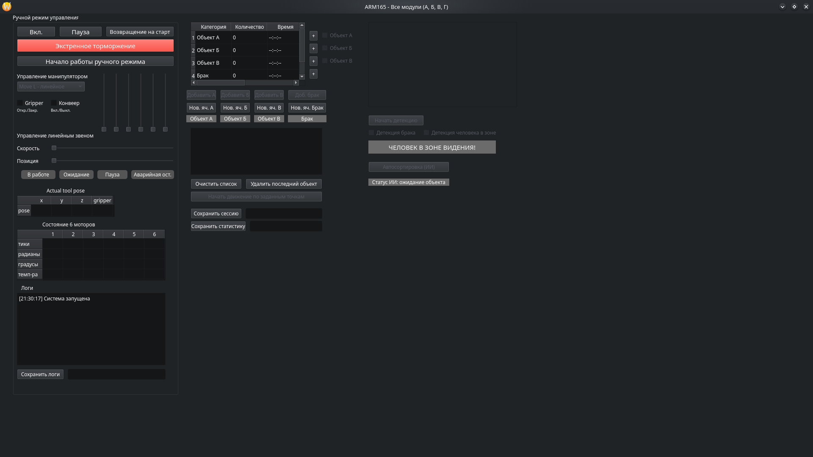
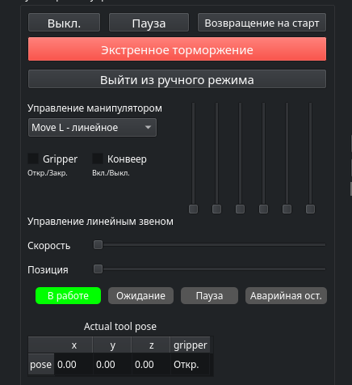
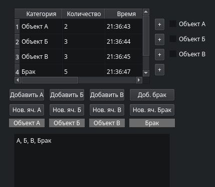
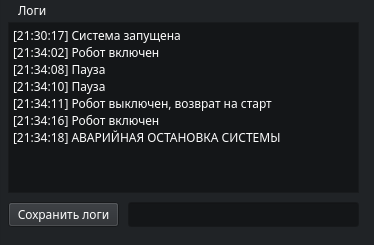

# ARM165 - Система управления роботизированной ячейкой

## Описание проекта
Данное ПО - это GUI для управления промышленной коллаборативной роботизированной ячейкой ARM165.

Система поддерживает 4 модуля:
*   **Модуль А**: Ручной режим управления.
*   **Модуль Б**: Автоматическая сортировка по заданному списку.
*   **Модуль В**: Детекция объектов с помощью нейросетей (YOLO) и компьютерного зрения.
*   **Модуль Г**: Полностью автоматическая сортировка с использованием ИИ.




---

## Системные требования и подготовка (Ubuntu)

Программа разработана для работы в операционной системе **Ubuntu**. 

Перед началом работы необходимо обновить систему и установить базовые зависимости:
```bash
sudo apt update && sudo apt upgrade -y
```

Установите Python и систему управления пакетами:
```bash
sudo apt install python3 python3-pip python3-venv -y
```

Установите системные библиотеки для работы с камерами и GUI:
```bash
sudo apt install python3-pyqt5 qtcreator qt5-default -y
```

---

## Установка зависимостей Python

Создайте и активируйте виртуальное окружение:
```bash
python3 -m venv venv
source venv/bin/activate
```

Установите все необходимые библиотеки из файла `requirements.txt`:
```bash
pip install -r requirements.txt
```

---

## Подготовка нейросетевой модели (Модуль В и Г)

Для того чтобы программа распознавала объекты (Объект А, Б, В и Брак), необходимо обучить модель. Делается это **до** запуска основного файла `main.py`.

### Шаг 1: Сбор датасета
Создайте в корне проекта папку `database` (если её нет). Сделайте фотографии ваших объектов и разложите их по папкам:
*   `database/A/` — фото Объекта А
*   `database/B/` — фото Объекта Б
*   `database/V/` — фото Объекта В
*   `database/reject/` — фото Брака


### Шаг 2: Автоматическая разметка
Запустите скрипт, который автоматически найдет объекты на фото и создаст разметку в формате YOLO:
```bash
python auto_labelling.py
```
Скрипт создаст папку `labeled_dataset`.

### Шаг 3: Обучение модели
Запустите процесс обучения нейросети:
```bash
python train_defect_detector.py
```

---

## Запуск программы

Для запуска главного интерфейса выполните в терминале в виртуальном окружении venv:
```bash
python main.py
```


---

## Инструкция оператора (Как пользоваться)

### Модуль А. Ручной режим
1.  Нажмите кнопку **«Вкл.»** — робот подключится, загорится синий индикатор «Ожидание».
2.  Нажмите **«Начало работы ручного режима»** — разблокируются джойстики и ползунки.
3.  Выберите режим движения (MoveL или MoveJ) в выпадающем списке.
4.  Двигайте ползунки для управления суставами или линейным звеном.
5.  Используйте чекбоксы для управления схватом и конвейером.
6.  Кнопка **«Экстренное торможение»** мгновенно останавливает все процессы и блокирует управление.



### Модуль Б. Автосортировка по списку
1.  Нажмите кнопки **«Добавить А/Б/В/Брак»**, чтобы сформировать список объектов в нижнем окне.
2.  Нажмите **«Начать движение по заданным точкам»**. Ручной режим заблокируется, робот начнет перемещать объекты по очереди.
3.  Если ячейка заполнена (4 объекта), робот встанет на паузу, а лейбл загорится красным. Замените тару и нажмите **«Нов. яч. [А/Б/В/Брак]»**.
4.  Для остановки нажмите **«Очистить список»** или «Экстренное торможение».



### Модуль В. Детекция ИИ
1.  Поставьте галочки на чекбоксах **«Объект А/Б/В»** и **«Детекция брака»**, чтобы настроить, что именно искать.
2.  Нажмите кнопку **«Начать детекцию»** — откроется видеопоток с камеры, на котором будут обведены найденные объекты.
3.  Для проверки безопасности поставьте галочку **«Детекция человека в зоне»**. Если человек попадет в кадр, загорится красный лейбл «ЧЕЛОВЕК В ЗОНЕ ВИДЕНИЯ!».


### Модуль Г. Полная автосортировка (ИИ)
1.  Нажмите кнопку **«Автосортировка (ИИ)»**. Все остальные кнопки (ручные и списки) заблокируются.
2.  Система перейдет в режим ожидания. Как только камера увидит объект, робот автоматически начнет его перемещать.
3.  Если в кадре появится человек, система мгновенно остановится, а лейбл загорится красным.
4.  Если объектов нет более 20 секунд, робот вернется на старт и режим отключится.


---

## Логи и статистика

*   **Логи**: Отображаются в нижнем левом окне. Кнопка **«Сохранить состояние системы»** сохраняет их в `.txt` файл (путь и файл указываются в поле рядом).
*   **Статистика**: Таблица в правом верхнем углу. Кнопка **«Сохранить статистику»** сохраняет данные в `.xlsx` файл.
*   **Сохранение сессии**: Кнопка **«Сохранить сессию»** сохраняет текущий список объектов в `.txt` файл.


